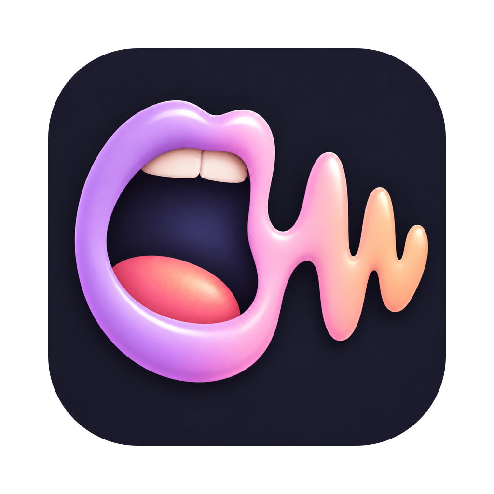

# screamr

Voice dictation and meeting recording for macOS, transcribed by ElevenLabs Scribe. Modeled on Wispr Flow.

## Run

```sh
mkdir -p ~/.config/screamr && printf '%s' "$ELEVEN_LABS_API_KEY" > ~/.config/screamr/api_key && chmod 600 ~/.config/screamr/api_key
./build.sh install   # builds, copies to ~/Applications (Raycast/Spotlight) and launches
```

The key can also come from the `ELEVEN_LABS_API_KEY` environment variable. Requires macOS 14.4+.

First launch asks for **Accessibility** (hotkeys and pasting; relaunch after granting), then **Microphone** and **System Audio Recording** on first use. In System Settings > Keyboard, set "Press Globe key to" to "Do nothing" so Fn doesn't open the emoji picker.

## Shortcuts

| Keys | Action |
|---|---|
| Hold Fn | Dictate, release to paste |
| Double-tap Fn, or Fn+Space | Hands-free dictation, Fn again to finish |
| Esc | Cancel dictation |
| Ctrl+Opt+Cmd+M | Start or stop a meeting recording |
| Ctrl+Opt+Cmd+D | Open the dashboard (or open the app again) |

## Dashboard

Home (stats and dictation history), Meetings (transcripts, re-transcribe), People, Dictionary, Snippets and Settings, in Catppuccin Mocha. Inside it: Cmd+1 to Cmd+6 switch sections, Cmd+K opens the command palette, `/` searches history, `?` lists shortcuts, Cmd+N adds an entry, Cmd+Plus / Cmd+Minus / Cmd+0 zoom, Esc closes.

Dictionary words are sent to Scribe as key terms. A replacement also rewrites what Scribe heard, which is how to fix names that sound like common words (Screamer to screamr). Snippets expand a spoken trigger phrase into text. Data lives in `~/Library/Application Support/Screamr/`.

Meetings are saved to `~/Library/Application Support/Screamr/Meetings/<date>/` as `mic.m4a`, `system.m4a` and `transcript.md`. The mic channel is labeled "You" (or "Room N" when several people share the mic); call audio is diarized into "Speaker N". Use headphones on calls, otherwise the mic also picks up the other side.

## People

After each meeting, every speaker with at least 3 seconds of speech gets a voice fingerprint, computed on this Mac with [FluidAudio](https://github.com/FluidInference/FluidAudio) (its Core ML models download once on first use). Fingerprints are matched against known people, so the same voice gets the same label in every meeting: "Unknown 3" until you name them in the People section, then their name, in past transcripts too. Unnamed people heard in two or more meetings are flagged as "Appears often". A lone voice on the mic starts out named "You". If one person gets split in two, merge them.

Each meeting folder keeps `mic.words.json` / `system.words.json` (Scribe's word timings) and `speakers.json` (speaker to person), so transcripts are re-rendered locally after renames, without paying Scribe again. Meetings recorded before this feature keep generic labels until re-transcribed.

## iPhone

`ios/` is a meeting recorder for in-person meetings: tap record, lock the phone, tap stop, and the recording is transcribed by Scribe with speakers separated. It shares the Scribe client, transcript rendering and palette with the Mac app, and keeps the same folder layout (`mic.m4a`, `mic.words.json`, `transcript.md`) under Documents/Meetings, which the Files app can browse. The API key goes in the app's Settings and is stored in the Keychain. Requires iOS 17 and [XcodeGen](https://github.com/yonaskolb/XcodeGen).

```sh
ios/run.sh          # booted simulator
ios/run.sh device   # connected iPhone (or DEVICE=<udid>)
```

## Sync

Meetings sync between the Mac and the iPhone through a small server you run yourself (`server/server.mjs`: Node, no dependencies, built-in SQLite). Each meeting is a record listing its files by SHA-256, and the files are uploaded once as blobs. Every file merges against the last synced version: a change on one device is pushed, a change on the other is downloaded, and files only disappear when the meeting is deleted.

- **iPhone recordings** reach the Mac, which recognizes the speakers; their names come back in `names.json`, so the phone shows them too.
- **Mac meetings** reach the iPhone as transcripts. Audio stays on the device that recorded it, plus the server.
- **When:** the Mac syncs on launch, every 5 minutes and after each transcription; the iPhone when opened, after a transcription and on pull-to-refresh.
- **Settings:** server URL and token, on the Mac in Settings > Sync (stored in `~/.config/screamr/sync.json`, mode 600), on the iPhone in Settings (token in the Keychain).

Deploying, as on munchkin: copy `server/server.mjs` to `~/services/screamr-sync/app/`, put `SCREAMR_SYNC_TOKEN=$(openssl rand -hex 32)` in `~/services/screamr-sync/.env`, run it as a read-only `node:26-alpine` container with `./screamr-sync/data` mounted at `/data`, and expose it to the tailnet only with `tailscale serve --bg --https=8796 http://127.0.0.1:8796`.

Backups: the data folder sits under `~/services`, which the nightly restic job already sends to B2. Restore `data/snapshot/sync.db` (a consistent copy refreshed hourly) as `data/sync.db`, plus `data/blobs/`. Devices notice the server is behind them and push back anything newer than the backup.

## Test

```sh
swift test
node --test server/
```
